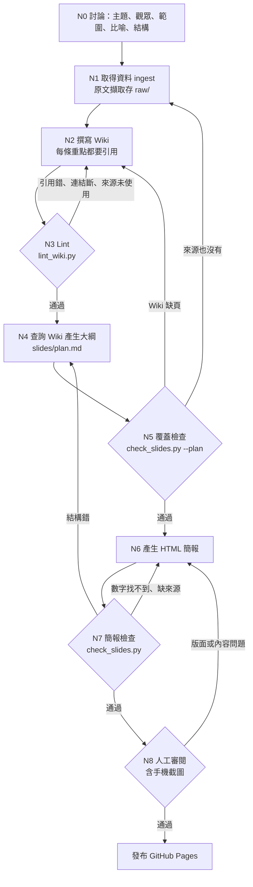

# SSD 為什麼會寫入放大？—— LLM Wiki × 教學 HTML 簡報

- **教學簡報**：https://CtyceT.github.io/ssd-waf-wiki/slides/
- **LLM Wiki 目錄**：[wiki/index.md](wiki/index.md)
- **規則（schema）**：[AGENTS.md](AGENTS.md)
- **完整工作紀錄**：[wiki/log.md](wiki/log.md)

## 1. 主題與簡介

用 Karpathy 的 LLM Wiki 模式，建立「SSD 寫入放大」的知識庫，再用它產生一份**給完全沒學過的非資工同學**的教學簡報。

| 層 | 內容 |
|---|---|
| `raw/` | 6 篇原始資料的原文擷取（Wikipedia、The SSD Review、Kingston、SNIA、Solidigm、Frankie 2012 論文），不可修改 |
| `wiki/` | 17 頁：7 個概念頁、6 個來源頁、1 個教學示意、總覽、目錄、紀錄；共 52 個引用，每個都能對回 raw 的某一句 |
| `slides/` | 14 張教學簡報，每張都標示來自哪些 Wiki 頁並附連結 |

**Wiki 與簡報的對應**：每張投影片的 `data-wiki` 屬性列出來源頁，頁尾顯示可點擊的連結；`tools/check_slides.py` 會檢查簡報上的每個數字都能在這些頁面找到。

## 2. Loop / Graph 設計



**哪些步驟會重複執行？**
- **N2 ⇄ N3**：每次改 Wiki 都要重跑 lint，直到引用、連結、來源使用都正確。
- **N5 → N2**：大綱需要的內容 Wiki 沒有時，回去補頁面；如果原始資料也沒有，就回 N1 找新來源。
- **N6 ⇄ N7**：簡報每次修改都要重跑檢查。
- 每個回圈最多重試 2 次，第 3 次就停下來交給人判斷。

**哪些地方需要檢查或重新生成？**
- **N3**：引用能不能對回原文、連結是否存在、每篇來源有沒有被使用。
- **N5**：大綱每張需要的 Wiki 頁是否存在。
- **N7**：張數、教學段落順序、每個數字都能在來源頁找到、每張都有來源頁尾。
- **N8**：人看內容配對是否正確、版面在手機上是否正常。

**為什麼這樣設計？**
- **簡報只能讀 Wiki，Wiki 只能讀 raw**：每一層只依賴下一層，出錯時可以一路追到原文是哪一句。
- **比喻的示意數字也要先存進 Wiki**（`explainers/`，標【推論】）：這樣「簡報不能有 Wiki 以外的數字」這條規則才能用程式自動檢查，不必靠模型自律。
- **檢查用程式而不是再問一次 LLM**：引用、數字、結構都是可以確定判斷的事，用程式檢查結果穩定，也不會和產生內容的模型有同樣的盲點；只有程式無法判斷的部分才交給人工審閱。

## 3. 一次實際執行的檢查紀錄

完整紀錄在 [wiki/log.md](wiki/log.md)，摘要如下：

| # | 節點 | 結果 | 發現的問題 | 處理 |
|---|---|---|---|---|
| 1 | N1 ingest | 6 篇完成 | S1 的 OP 算式擷取後變亂碼（上標遺失）；S3 擷取結果混入工具自己算的 6.7% | 兩者都標為不使用，寫入「待確認」 |
| 2 | N0 討論 | 完成 | 使用者只選核心 5 頁，但簡報結構需要「解法」 | 記錄下來，交給 N5 驗證 |
| 3 | N3 lint 第 1 次 | 通過＋6 個警告 | 來源頁都是孤兒頁；S3、S6 沒被任何概念頁使用 | 概念頁加上來源連結 |
| 4 | N5 覆蓋第 1 次 | **失敗 6 項** | 缺 TRIM、Over-provisioning 頁與筆記本比喻 | 回 N2 用既有來源補 3 頁 |
| 5 | N3 lint 第 2 次 | 通過 | — | 17 頁、52 個引用 |
| 6 | N5 覆蓋第 2 次 | 通過 | — | — |
| 7 | N7 簡報第 1 次 | **失敗** | 回報「缺少問題段」，實際上是**檢查工具的 bug**：`<br>` 讓 3 張投影片被跳過 | 修正解析器，加入張數自我驗證 |
| 8 | N7 簡報第 2 次 | 通過 | 故意放 2 個錯誤數字測試，兩個都被抓到 | 還原 |
| 9 | N8 人工審閱 | **發現問題** | 手機直向畫面整個空白 | 改用絕對定位縮放，重新截圖確認 |

## 4. 反思

**哪一個節點最常出錯？**
**N2「撰寫 Wiki」的覆蓋範圍**。它和簡報需要的內容對不上，直接造成 N5 的 6 個失敗，是這次失敗次數最多的單一原因。根本原因是討論時「Wiki 範圍」和「簡報結構」分開決定：只選了核心 5 頁，卻選了需要「解法」的結構。

另外兩個值得注意的出錯點：
- **N1 擷取**：資料在一開始就可能是壞的（亂碼、工具自己加的數字）。如果沒在 ingest 時攔下，錯誤數字會一路傳到簡報。
- **N7 檢查工具本身**：檢查器有 bug 時，會在「通過」的外表下漏檢。這次是剛好漏掉唯一的「問題」段才露出馬腳；不然 3 張投影片會在沒檢查的情況下被當成通過。

**發現問題後，把檢查往前移到哪一個步驟？**
- **從 N5 移到 N3**：第 1 次 lint 其實已經警告 S3、S6 沒被使用，但警告沒擋下流程。現在「來源未被使用」在 N3 就是錯誤，必須補成概念頁或註明「不使用：原因」，不會再拖到大綱階段。
- **從 N5 再往前移到 N0 討論**：決定簡報結構時，要同時列出每個段落需要哪些 Wiki 頁。
- **從 N7 移到 N1**：數字的可信度在 ingest 時就檢查，只收原文引號內的數字。

**有沒有因此修改 workflow / graph？為什麼？**
有，改成 **workflow v2**（寫在 AGENTS.md 第 5 節）：
1. N3 lint：來源未使用由警告改為錯誤（已測試：拿掉 S6 的連結 → lint 失敗）。
2. N0 討論：結構與所需 Wiki 頁一起決定。
3. N1：排除擷取工具自行加入的數字。
4. N7：檢查工具要自我驗證張數，避免「安靜的漏檢」。
5. N8：人工審閱必須包含手機截圖。

原因是：**越晚發現的錯誤，要回頭重做的節點越多**。N5 才發現缺頁，要重跑 N2、N3、N5；如果在 N3 就擋下，只要重跑 N2、N3。另外這次也學到，**檢查工具本身也是一個會出錯的節點**，所以它也需要被檢查。

**目前仍有的限制**：數字檢查只確認「數字有出現在來源頁」，不確認「數字和描述的配對正確」，例如把 7% 和 28% 對調仍會通過。這部分目前只能靠 N8 人工審閱。

## 指令

```bash
python3 tools/lint_wiki.py          # N3
python3 tools/check_slides.py --plan  # N5
python3 tools/check_slides.py         # N5 + N7
python3 -m http.server 8000           # 預覽 http://localhost:8000/slides/
```
